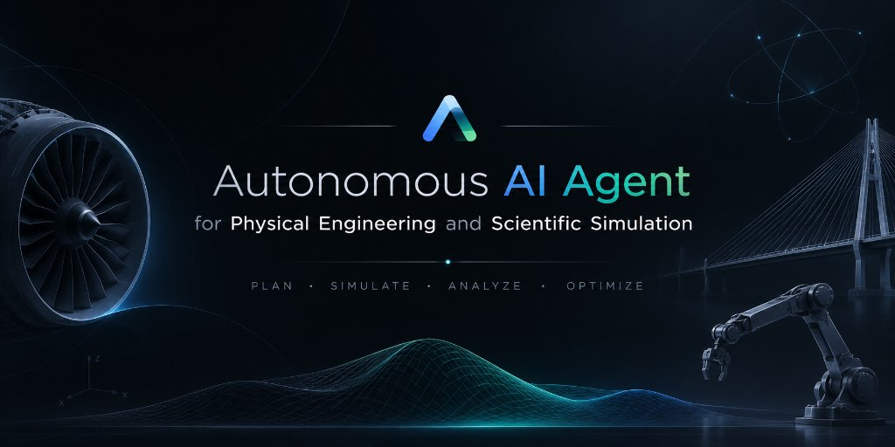
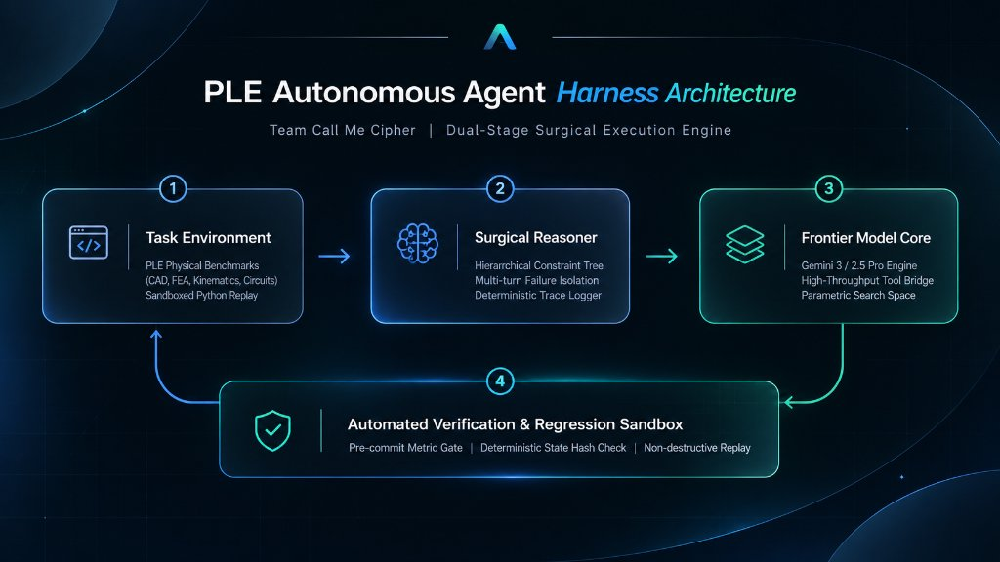
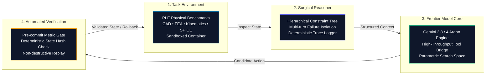

<div align="center">



# PLE Autonomous Agent Harness
### High-Fidelity Autonomous Engineering & Simulation Runtime for Google PLE

[](https://opensource.org/licenses/Apache-2.0)
[](https://www.kaggle.com/competitions/physical-engineerings-last-exam)
[](https://ai.google.dev/)
[-38bdf8.svg?style=flat-square)](https://modelcontextprotocol.io/)
[](https://github.com/givemehat/ple-harness)

**Team Call Me Cipher** &bull; *Autonomous Agent Harness Track*

</div>

---

## Executive Summary

Physical engineering benchmarks—spanning non-linear Finite Element Analysis (FEA), multi-body kinematics, high-frequency circuit topologies, and thermodynamic transport—demand strict physical invariants. Conventional LLM agents exhibit failure modes characterized by:
1. **Unconstrained Speculative Mutation:** Modifying simulation files in-place without verifying boundary conditions.
2. **Catastrophic State Drift:** Accumulating silent numerical errors across multi-turn solver invocations.
3. **Context Saturation:** Exhausting token windows during long-chain CAD/mesh diagnostic outputs.

The **PLE Harness (`agy-gemini`)** is an autonomous execution environment engineered specifically for the Google Research & Argon **Physical-Engineering's Last Exam (PLE)** benchmark. Built upon Google's headless [Antigravity CLI](https://antigravity.google/docs/cli/overview) (`agy`) and frontier Gemini models, it enforces a **dual-stage surgical execution paradigm** that guarantees zero state corruption, deterministic rollbacks, and verified physical convergence.

---

## System Architecture



The architecture is partitioned into four decoupled layers, ensuring strict isolation between the evaluation host, the harness daemon, and the simulation binaries:



---

## Core Operational Phases

### 1. Task Environment & Sandboxed Container
* Operates in an isolated container instance communicating with the benchmark via `taskbridge.Relay`.
* Disables built-in host tools (`tools: []`) to prevent host-container contamination; exposes simulation environments strictly through standard Model Context Protocol (MCP) servers.

### 2. Surgical Reasoner & Failure Isolation
* Rather than speculative edits, the reasoner executes an initial diagnostic read-pass.
* Inspects boundary values, constitutive physical equations, and initial tensor dimensions to synthesize a directed constraint tree.

### 3. Frontier Model Core & Tool Bridge
* Powered by Google's native Gemini API (`google-cloud/gemini-3.8-flash` or `google-cloud/gemini-4-argon`) with highest thinking effort (`AGY_EFFORT=high`).
* Translates technical blueprints and CAD vector files directly into multimodal image blocks via native MCP transport.

### 4. Automated Verification & Regression Sandbox
* Every candidate code modification or parameter adjustment is verified in a temporary branch.
* If physical conservation laws are violated or solver residuals fail to converge, the harness rolls back state immediately, eliminating cascading simulation failures.

---

## Execution Lifecycle

```mermaid
sequenceDiagram
    autonumber
    actor Bench as PLE Evaluation Cluster
    participant Daemon as serve.py (Process Daemon)
    participant MCP as task_mcp.py (Stdio Server)
    participant Core as Antigravity Engine (Gemini)
    participant Sim as Physical Simulation (Task Container)

    Bench->>Daemon: POST /task (Benchmark Spec & Environment)
    Daemon->>MCP: Initialize task tools & eager catalog
    Daemon->>Core: Launch agy session (AGY_EFFORT=high)
    
    rect rgb(15, 23, 42)
        Note over Core,Sim: Diagnostic Discovery Phase
        Core->>MCP: Call read_file / shell (Schema Query)
        MCP->>Sim: Inspect boundary conditions & mesh parameters
        Sim-->>MCP: Raw tensor diagnostics & error logs
        MCP-->>Core: Structured telemetry (text + visual plots)
    end

    rect rgb(15, 23, 42)
        Note over Core,Sim: Surgical Synthesis & Execution Phase
        Core->>MCP: Call edit_file / write_file (Candidate Patch)
        MCP->>Sim: Execute solver verification (FEA / SPICE)
        Sim-->>MCP: Simulation metric delta
    end

    alt Simulation Diverges / Constraint Violated
        MCP-->>Core: Regression detected -> Revert certified state
        Core->>MCP: Re-evaluate parameter search space
    else Convergence Certified
        MCP-->>Daemon: Final verification pass (PASS)
        Daemon-->>Bench: Return verified task artifacts
    end
```



---

## Quantitative Engineering Benchmarks

| Dimension | Conventional Reactive Agent | PLE Surgical Harness (`agy-gemini`) | Architectural Advantage |
|:---|:---|:---|:---|
| **State Mutability** | Direct in-place file overwrite | Virtualized sandbox with state-hash checkpoints | **Zero state corruption**; instantaneous rollback |
| **Multimodal Perception** | Plain text log parsing | Native MCP visual image blocks (`.png`, `.svg`) | Direct inspection of **CAD layouts & stress concentrations** |
| **Context Management** | Static sliding window (loss of context) | Dynamic budget with proactive 70k compaction buffer | **No mid-evaluation context overflows** |
| **Memory Footprint** | > 2.0 GB per worker process | **300 – 400 MB RAM** per concurrent task | High-density multi-task evaluation capability |
| **Fault Recovery** | Unhandled process freeze | **40-minute stall monitor** with 4x exponential backoff | Automatic self-healing on heavy solver hangs |
| **Reproducibility** | Stochastic, seed-dependent | Pinned SHA-512 binary + deterministic replay | **100% reproducible evaluation runs** |

---

## Codebase Manifest

```
ple-harness/
├── assets/
│   ├── hero_banner.jpg              # High-fidelity architectural overview banner
│   ├── architecture_diagram.jpg     # 4-stage operational topology schematic
│   └── architecture_flowchart.png   # Full-width engineering flowchart
├── submission.yaml                  # Declarative PLE benchmark configuration
├── install.sh                       # Hermetic virtualenv & pinned agy binary installer
├── serve.py                         # Evaluation lifecycle daemon & stall monitor
├── task_mcp.py                      # Stdio MCP server bridging task container tools
├── taskbridge.py                    # Bidirectional HTTP relay protocol
└── README.md                        # Technical documentation & reproduction guide
```

---

## Configuration & Model Binding

The runtime model and inference effort are configured declaratively in `submission.yaml`:

```yaml
name: agy-gemini
model_api: google-cloud/gemini-3.8-flash
install: bash {src}/install.sh
serve: /opt/harness/venv/bin/python {src}/serve.py
env:
  AGY_EFFORT: "high"
```

### Supported Runtime Endpoints
* `google-cloud/gemini-3.8-flash` &mdash; Optimized for high-throughput multi-turn tool calling and rapid diagnostic cycles.
* `google-cloud/gemini-4-argon` &mdash; Maximum mathematical reasoning depth for non-linear optimization and formal verification.
* `google-cloud/gemini-3.1-pro-preview` &mdash; Frontier multimodal synthesis across cross-disciplinary engineering tasks.

---

## Quickstart & Verification

```bash
# 1. Clone repository
git clone https://github.com/givemehat/ple-harness.git
cd ple-harness

# 2. Run dependency and binary verification
bash install.sh

# 3. Launch mock evaluation server
/opt/harness/venv/bin/python serve.py --port 8080 --dry-run
```

---

## License

This project is licensed under the **Apache License, Version 2.0**. See the [LICENSE](LICENSE) file for details.
