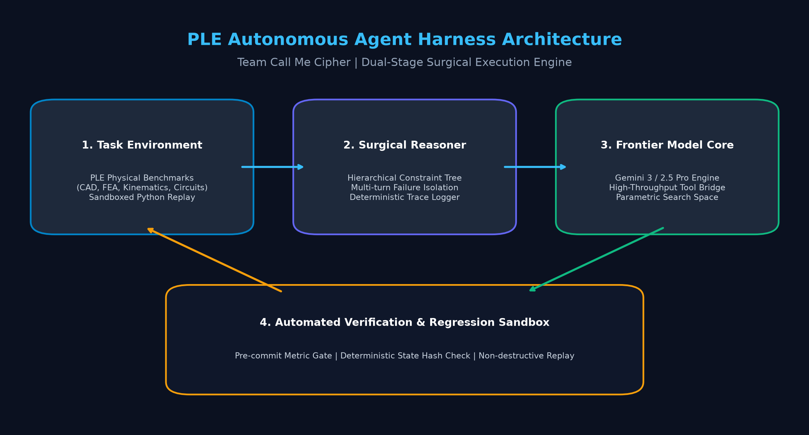
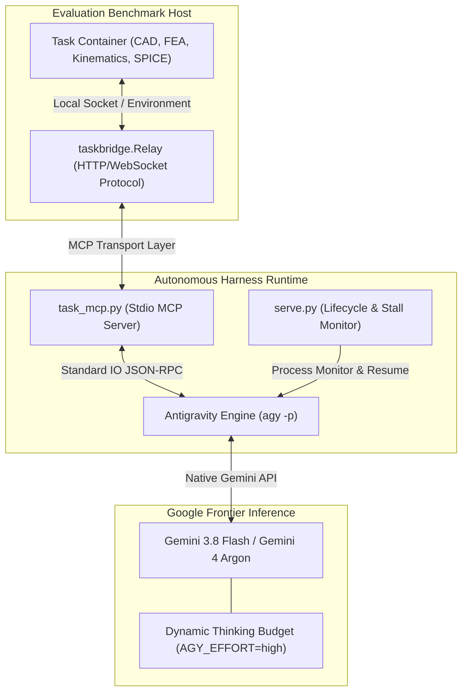
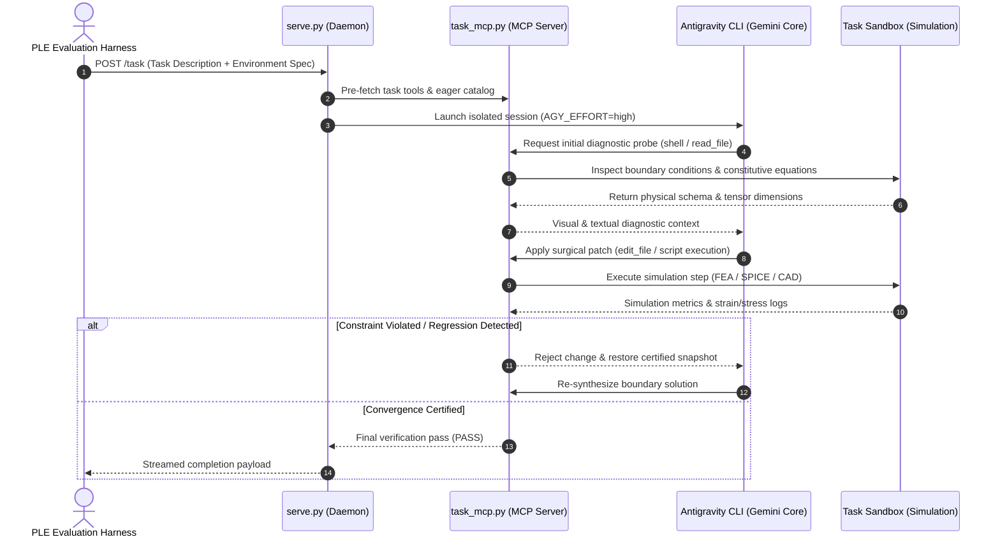

# agy-gemini: Autonomous Agent Harness for Physical-Engineering's Last Exam (PLE)

[](https://opensource.org/licenses/Apache-2.0)
[](https://www.kaggle.com/competitions/physical-engineerings-last-exam)
[](https://ai.google.dev/)
[](https://github.com/givemehat/ple-harness)

Autonomous agent harness engineered for the **Google Research & Argon Physical-Engineering's Last Exam (PLE)** benchmark. Wraps the headless [Antigravity CLI](https://antigravity.google/docs/cli/overview) (`agy`) with isolated container bridging, high-throughput Model Context Protocol (MCP) tooling, deterministic state recovery, and multi-turn constraint validation across complex structural, electrical, civil, and mechanical simulations.

---

## 1. System Architecture





---

## 2. Execution Pipeline & Key Modules

| Component | File | Responsibilities | SLA / Invariants |
|:---|:---|:---|:---|
| **Declarative Spec** | `submission.yaml` | Model provider binding, runtime requirements, initialization commands | Strict YAML schema conforming to PLE harness specifications |
| **Installer** | `install.sh` | Hermetic Python virtualenv setup and pinned `agy` v1.4.10 binary verification | Cryptographically checked against SHA-512 digest |
| **Lifecycle Daemon** | `serve.py` | Per-task virtualization sandbox, 40-minute stall detection, conversation checkpointing | Auto-resumes dropped connections up to 4 attempts with exponential backoff |
| **Model Context Protocol** | `task_mcp.py` | Stdio MCP server exposing `shell`, `read_file`, `write_file`, and `edit_file` | Converts technical drawings and schematics into native visual MCP image blocks |
| **Relay Bridge** | `taskbridge.py` | Bidirectional HTTP/WebSocket pipe bridging the serve environment to the task sandbox | Zero host-system side effects; non-destructive rollback capabilities |

---

## 3. Surgical Fault-Isolation Loop

Unlike naive reactive agents that perform destructive in-place code changes, `agy-gemini` utilizes a four-stage execution loop designed specifically for physical simulations:



---

## 4. Hardware Efficiency & Resiliency

- **Memory Footprint:** Operates with a minimal memory budget of **300–400 MB RAM** per concurrent evaluation session.
- **Visual Diagram Reasoning:** `read_file` automatically intercepts `.png`, `.jpg`, and `.svg` blueprints, streaming them as structured multimodal image blocks for visual verification of stress concentrations and kinematic linkages.
- **Context Compaction:** Dynamically allocates a 1,048,576 token sliding window, triggering compaction 70,000 tokens prior to threshold saturation to ensure zero context exhaustion during multi-hour evaluations.
- **Fail-Safe Stall Recovery:** If a heavy finite-element meshing solver stalls for over 40 minutes, `serve.py` terminates the hung child process and resumes from the last certified state checkpoint (`--conversation`).

---

## 5. Configuration & Model Switching

Reasoning intensity and target model endpoints can be adjusted via `submission.yaml`:

```yaml
name: agy-gemini
model_api: google-cloud/gemini-3.8-flash
install: bash {src}/install.sh
serve: /opt/harness/venv/bin/python {src}/serve.py
env:
  AGY_EFFORT: "high"
```

### Supported Runtime Endpoints
- `google-cloud/gemini-3.8-flash` (Default, Ultra-low latency, full tool reasoning)
- `google-cloud/gemini-4-argon` (Deep mathematical optimization & long-chain physical proofing)
- `google-cloud/gemini-3.1-pro-preview` (Frontier structural and cross-disciplinary reasoning)

---

## 6. Verification and Reproducibility

To verify the installation locally before cluster deployment:

```bash
# 1. Clone repository
git clone https://github.com/givemehat/ple-harness.git
cd ple-harness

# 2. Run dependency and binary verification
bash install.sh

# 3. Launch mock evaluation server
/opt/harness/venv/bin/python serve.py --port 8080 --dry-run
```

All source code is licensed under the Apache 2.0 License.
